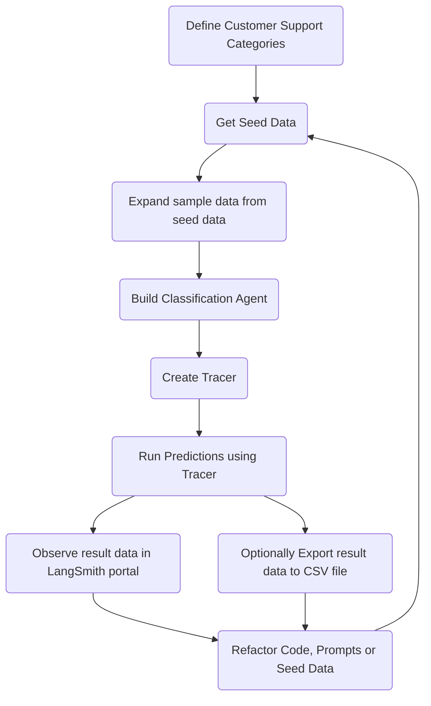

## Week 4 Project

# Categorization Eval App

By Luis C Trevino, 2026

## Project Links

[Documentation](https://docs.google.com/document/d/1hhCq1UY4R2XK21wq4UDZhqfaGZ73WHj4AtVp2LDVZus/edit?tab=t.0)

[Sample data](./kb_eyeglass_01.json)

[Demo](.)

## Project Description

The Classification Eval application will evaluate an intent classifier for SuperGlasses, an online eyeglass store customer support system. The classifier predicts which category a customer ticket belongs to. 

Evaluations of the classification system will be executed by recording the actual values against the expected ones. We will manually annotate failures, define failure categories from your observations, make one focused prompt improvement, and compare the before-and-after results. 

The dataset would be generated from 25 seed tickets, which will later be expanded into 100 tickets by using LLM-driven paraphrasing.
The possible categories are: order status, refund request, product issue, account help, and “other”.


## Setup
```
uv sync
```

## Run Categorization Eval App

The Ingestion app only needs to be run once, or every time the Knowledge Base data (json) changes.
```
py categ_eval.py
```

## App Flow


## Sample user query

You can use the User Query below to test the Retriever app:

My front load washer door won't open. What can I do?
